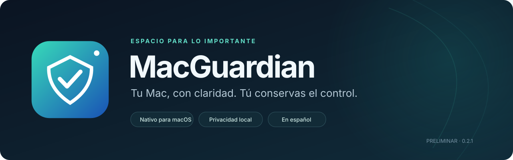
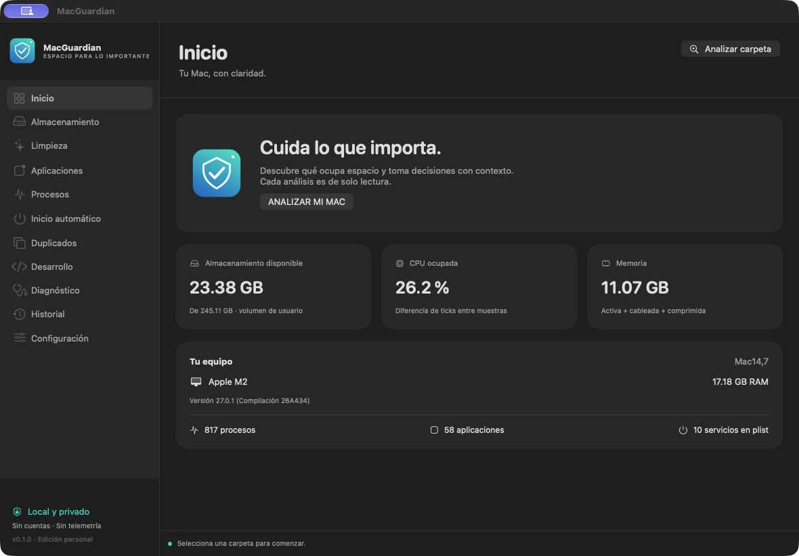
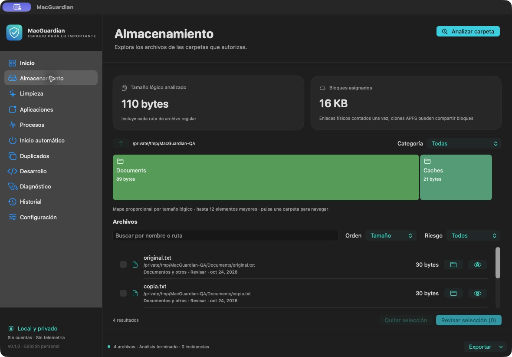
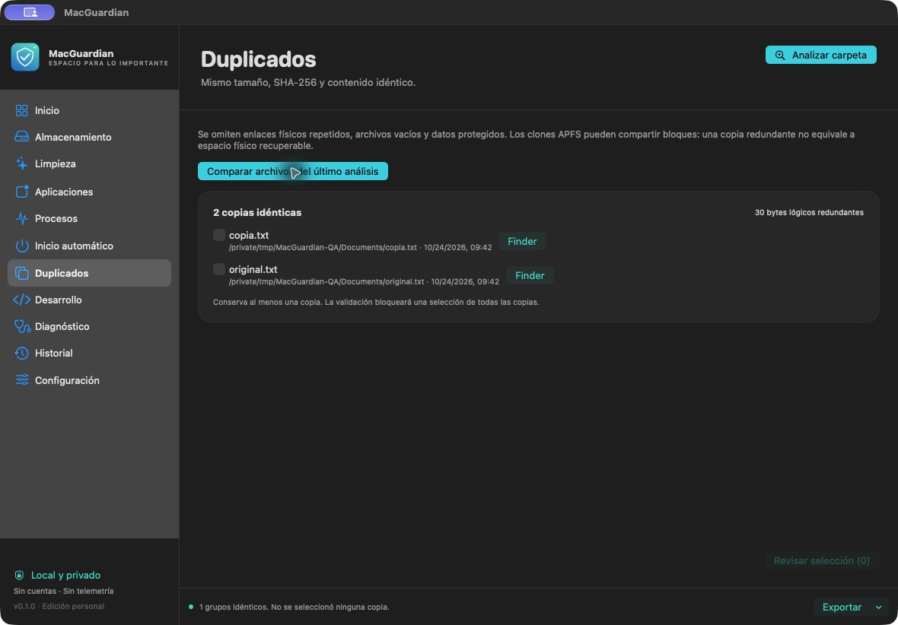
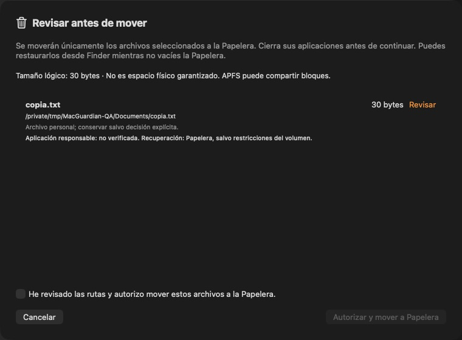
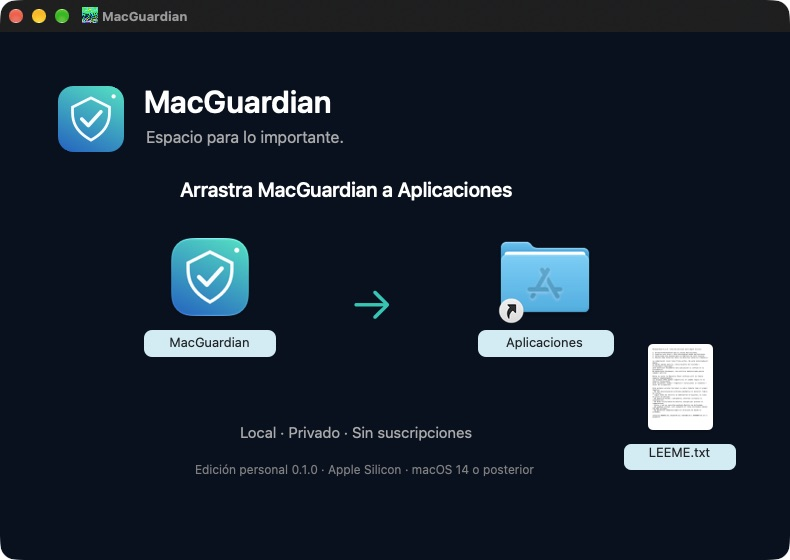

<p align="center">
  
</p>

<p align="center">
  <strong>Comprende tu almacenamiento. Revisa cada acción. Conserva el control.</strong><br>
  Una aplicación nativa para macOS, en español y con privacidad local.
</p>

<p align="center">
  <a href="https://github.com/popcodex/MacGuardian/actions/workflows/macos.yml"></a>
  
  
  
  
</p>

<p align="center">
  <a href="https://github.com/popcodex/MacGuardian/releases/tag/v0.1.0"><strong>Descargar MacGuardian</strong></a> ·
  <a href="#capturas">Capturas</a> ·
  <a href="#instalación">Instalación</a> ·
  <a href="TESTING.md">Verificación</a> ·
  <a href="ROADMAP.md">Hoja de ruta</a>
</p>

---

## Tu Mac, con claridad

MacGuardian reúne análisis de almacenamiento, revisión de archivos, duplicados, aplicaciones y diagnóstico en una interfaz oscura. Utiliza **SwiftUI y AppKit**, funciona principalmente sin conexión y no requiere cuentas, suscripciones ni servicios externos.

La prioridad es **seguridad → fiabilidad → funcionalidad → rendimiento → diseño**. Los análisis son de solo lectura; las modificaciones son acciones independientes que necesitan tu autorización. No hay limpiezas ocultas, puntuaciones inventadas ni promesas de acelerar mágicamente macOS.

> [!IMPORTANT]
> **0.1.0 es una primera versión funcional, no el producto completo.** El código y el instalador se publican como una versión preliminar. La compilación es arm64, tiene firma ad hoc y **no está notarizada**; la evaluación de Gatekeeper devuelve rechazo. Se comprobó su apertura local en el Mac de desarrollo. Revisa [los límites actuales](#estado-y-limitaciones) antes de utilizarla.

## Capturas

### Un panel para entender tu equipo



### Explora el almacenamiento con contexto



<table>
  <tr>
    <td width="50%"><strong>Duplicados verificados</strong><br><br></td>
    <td width="50%"><strong>Revisión antes de actuar</strong><br><br></td>
  </tr>
</table>

Las imágenes son capturas reales de la versión publicada. Las pantallas de archivos usan únicamente un conjunto sintético de prueba; sus tamaños pequeños son intencionales. No contienen documentos personales ni resultados simulados dentro de la aplicación.

## Qué puedes hacer

| Herramienta | Función disponible |
|---|---|
| **Inicio** | Consultar equipo, sistema, volumen, CPU entre muestras, memoria y contadores de inventarios. |
| **Almacenamiento** | Analizar una carpeta autorizada, navegar por el mapa proporcional, buscar y ordenar archivos. |
| **Limpieza** | Revisar cachés, registros antiguos, instaladores y otros candidatos; mover archivos seleccionados a Papelera con confirmación. |
| **Aplicaciones** | Ver paquetes instalados, versión, identificador, ejecución y datos asociados por coincidencia exacta; conservar sus datos al retirar el paquete. |
| **Procesos** | Consultar PID, padre, usuario, CPU, memoria y estado; solicitar cierre de aplicaciones permitidas con advertencia. |
| **Inicio automático** | Revisar plist accesibles y abrir los ajustes oficiales para gestionar elementos de terceros. |
| **Duplicados** | Comparar tamaño, SHA-256 y contenido; omitir enlaces físicos repetidos y conservar una copia. |
| **Desarrollo** | Identificar datos regenerables y distinguirlos de entornos, dependencias e imágenes que deben conservarse. |
| **Diagnóstico** | Consultar métricas disponibles de CPU, memoria, swap, presión, almacenamiento, batería y alimentación. |
| **Historial y configuración** | Revisar operaciones locales, gestionar exclusiones, cambiar apariencia e intervalo, y activar un monitor de menú opcional. |
| **Informes** | Exportar el resultado de un análisis como JSON o CSV. |

## Instalación

**Requisitos:** Mac con Apple Silicon. Objetivo mínimo macOS 14; ejecución validada únicamente en **macOS 27.0.1, Apple M2**. La compatibilidad con otras versiones sigue pendiente de prueba.

1. Descarga **[MacGuardian.dmg de la versión 0.1.0](https://github.com/popcodex/MacGuardian/releases/download/v0.1.0/MacGuardian.dmg)**.
2. Abre el DMG y arrastra **MacGuardian** al enlace **Aplicaciones**.
3. Expulsa el disco y abre la aplicación desde Aplicaciones.
4. Elige una carpeta para realizar el primer análisis de solo lectura.

<p align="center">
  
</p>

> [!NOTE]
> **Firma y Gatekeeper.** Esta entrega utiliza firma ad hoc, sin identidad Developer ID ni notarización. Si macOS bloquea su apertura, revisa **Ajustes del Sistema → Privacidad y seguridad** para autorizar individualmente la aplicación solo si confías en su procedencia. Una política administrada puede impedirlo. **No desactives Gatekeeper ni otras protecciones globales.**

La versión descargable incluye el instalador, el paquete de aplicación archivado, el proyecto y sus sumas SHA-256. No instala helpers privilegiados ni configura inicio automático.

## Cómo usarla con seguridad

1. **Autoriza el alcance.** Selecciona una carpeta, Descargas o una unidad externa. El análisis respeta permisos y exclusiones.
2. **Comprende los resultados.** Consulta rutas, tamaños y motivos. Que un archivo sea antiguo o una caché no significa que sea prescindible.
3. **Revisa la selección.** Nada se selecciona automáticamente. Los datos protegidos no están disponibles para la limpieza.
4. **Decide por separado.** El movimiento a Papelera exige revisar la lista y confirmar la autorización. La aplicación no vacía la Papelera.
5. **Conserva una copia.** En duplicados, se bloquea una selección que no deje una copia verificable.

Para recuperar un archivo que siga en Papelera: **Finder → Papelera → seleccionar → Sacar de la papelera**. Las posibilidades de recuperación dependen del volumen y de que el elemento permanezca allí.

### Tamaño no equivale a espacio recuperable

- **Tamaño lógico:** bytes de contenido de los archivos encontrados.
- **Bloques asignados:** `st_blocks × 512`, contando cada dispositivo e inodo una sola vez.
- **APFS:** clones y snapshots pueden compartir bloques. Ninguna de esas cifras garantiza espacio recuperable.
- **Papelera:** mover un archivo allí no libera necesariamente espacio hasta vaciarla desde Finder.
- **CPU por proceso:** el valor de `ps` es un promedio durante la vida del proceso y puede superar 100 % con varios núcleos. La CPU del panel usa ticks entre muestras.

## Estado y limitaciones

**Verificado localmente:** compilación Release arm64, apertura de la aplicación incluida en el DMG, firma ad hoc e integridad del paquete, once pruebas del núcleo y comprobaciones visuales. Consulta [TESTING.md](TESTING.md) y [las evidencias publicadas](Docs/verification/).

**Pendiente o limitado:**

- No hay desinstalación profunda automática ni detector fiable de restos. Los datos asociados se conservan.
- Los Login Items de terceros se administran desde Ajustes. El inventario de plist es parcial y no prueba que un servicio esté cargado.
- No se purgan Docker, simuladores, entornos virtuales ni dependencias de proyectos.
- iCloud/File Provider, paquetes, `.git`, enlaces y rutas excluidas se omiten. La omisión de elementos ubicuos se informa como incidencia.
- El escaneo tiene un límite de 250 000 entradas; la lista muestra hasta 3000 archivos por filtro. Los resultados parciales se identifican.
- Algunas métricas avanzadas no están implementadas: ciclos y salud de batería, energía por proceso, temperaturas y tasas de disco o red. Se ofrece acceso a Monitor de Actividad.
- No se probaron limpiezas reales, desinstalaciones ni cierres forzados sobre datos o aplicaciones personales.

La cobertura completa y los siguientes pasos están en [ROADMAP.md](ROADMAP.md). No se presenta esta versión como sustituto completo de las herramientas del sistema.

## Privacidad y permisos

MacGuardian no inicia conexiones de red, no recopila telemetría y no utiliza cuentas. No solicita administrador ni exige acceso completo al disco. TCC y otros permisos de macOS pueden dejar partes sin analizar.

Las preferencias se guardan en el dominio `local.macguardian.app`; el historial, en `~/Library/Application Support/MacGuardian/history.json`. El historial y los informes contienen rutas locales: revísalos antes de compartirlos. Si el historial no puede leerse o escribirse, se bloquean las modificaciones.

Los detalles de las validaciones y sus límites frente a cambios concurrentes están documentados en [SECURITY.md](SECURITY.md).

## Desarrollo

La aplicación no tiene dependencias externas en tiempo de ejecución. El proyecto utiliza Swift Package Manager y frameworks del sistema.

```sh
git clone https://github.com/popcodex/MacGuardian.git
cd MacGuardian

# Ejecutar las pruebas del núcleo
./Scripts/test.sh

# Construir Release para Apple Silicon y firmar localmente
./Scripts/build.sh

# Instalar únicamente las herramientas de empaquetado, dentro del proyecto
python3 -m pip install --target .build/packaging --only-binary=:all: \
  -r Scripts/packaging-requirements.txt

# Generar el instalador personalizado
./Scripts/package-dmg.sh
```

**Entorno validado:** Swift 6.4 y Command Line Tools con SDK de macOS 27. La compilación con otras combinaciones de herramientas debe verificarse. Los scripts redirigen sus cachés al proyecto.

La aplicación se firma en una carpeta temporal fuera de iCloud y se archiva como `dist/MacGuardian-app.zip` antes de incorporarla al DMG. Esto evita que File Provider añada metadatos al paquete firmado. Las bibliotecas MIT `ds-store` y `mac-alias` se utilizan únicamente para generar el diseño del instalador; no se incluyen en la aplicación. Consulta [THIRD_PARTY.md](THIRD_PARTY.md).

Para una distribución con identidad válida, establece `MACGUARDIAN_SIGN_IDENTITY` al construir y sigue el proceso oficial de notarización con tus propias credenciales. El repositorio no contiene credenciales de firma.

### Estructura del proyecto

```text
Sources/
├── MacGuardian/          Interfaz SwiftUI, ventana AppKit y coordinación
└── MacGuardianCore/      Escaneo, seguridad, duplicados y métricas
Tests/                   Pruebas con archivos temporales sintéticos
Scripts/                 Compilación, recursos, instalador y verificación
Resources/               Icono, logotipo, fondo e Info.plist
Docs/
├── media/               Portada y capturas reales
└── verification/        Resultados e integridad de la entrega
```

## Documentación

| Documento | Contenido |
|---|---|
| [Arquitectura](ARCHITECTURE.md) | Capas, concurrencia, recursos y distribución. |
| [Seguridad](SECURITY.md) | Validaciones, recuperación, permisos y límites. |
| [Pruebas](TESTING.md) | Qué se ejecutó y qué no se ha verificado. |
| [Hoja de ruta](ROADMAP.md) | Cobertura del prompt y funcionalidades pendientes. |
| [Cambios](CHANGELOG.md) | Historial de versiones. |
| [Contribución](CONTRIBUTING.md) | Cómo reproducir problemas sin exponer datos personales. |
| [Investigación](Docs/RESEARCH.md) | Referencias y decisiones basadas en fuentes primarias. |
| [Requisitos originales](Docs/PROMPT-MAESTRO.txt) | Alcance solicitado; no es una lista de funciones ya terminadas. |

---

<p align="center">
  <br>
  <strong>Espacio para lo importante.</strong><br>
  Proyecto personal de <a href="https://github.com/popcodex">popcodex</a> · Versión preliminar 0.1.0
</p>
